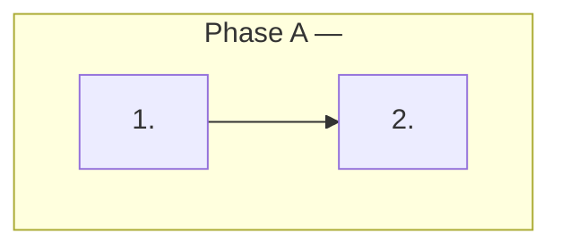

# `tasks.md` schema: tasks, checkpoints, dependency graph, waves

## 1. Structure

```markdown
# Implementation Plan: <Feature Name>          ← exact title prefix

## Overview
<phases in one paragraph: what each phase builds and why that order;
 the spine task every later task writes into; any task-numbering caveat>

## Task Dependency Graph

Machine-readable wave definitions for the task runner:
```json
{"waves": [
  {"wave": 1, "tasks": [1], "description": "Phase A — <what and why it is alone>"},
  {"wave": 2, "tasks": [2, 3], "description": "Phase A — <why these are independent>"}
]}
```

## Tasks
## Phase A: <name>
- [ ] 1. <Task title>
  - [ ] 1.1 <sub-task: one file or one logical unit>
  - [ ] 1.2 …
  - _Requirements: 1.1, 1.2, 8.1_

- [ ] 5. Checkpoint — Phase A complete
  - Run `<exact command>`. Confirm all of: <pass criteria>. Ask the user if questions arise before <irreversible step>.

## Notes
<constraints carried from requirements; hard gates; what not to do>
```

Phases in execution-oriented specs follow the feature lifecycle: Backend
Implementation (B), Backend Tests (C), Frontend Implementation (D), Frontend
Tests (E), E2E (F). Domain-oriented specs phase by data dependency (what each
phase needs that the previous produced).

## 2. Task grammar

- Top-level task: `- [ ] N. <imperative title>`; sub-task: `- [ ] N.M …`.
  `[x]` when done. Numbers are stable; file order may differ from numeric
  order when phases were reorganised, and the overview says so.
- A sub-task is one logical unit (one entity, one use case, one component,
  one hook, one migration) and names the file path when it is known.
- Every top-level task ends with `_Requirements: <ids>_`. A task with no
  requirement is scope creep; a requirement with no task is a gap.
- Tests are tasks, not afterthoughts: unit, property, integration, E2E, and
  accessibility tasks appear in the plan with their own requirement refs.
- Tasks for removing superseded code and reconciling existing contracts come
  **before** the tasks that build on them.
- A task never asks for something the code inventory says already exists;
  it says "extend" or "wire" instead.

## 3. Checkpoints

- A checkpoint is a task: `N. Checkpoint — <phase> complete`, with the exact
  commands, the pass criteria ("all of: …"), and the instruction to ask the
  user before touching anything irreversible or high-blast-radius.
- Hard gates are checkpoints the sequencing and tracker name explicitly:
  migration upgrade → downgrade → upgrade plus drift check; login E2E green
  on an encrypted table; all routing personas unchanged; no real PII
  before encryption. Nothing after a hard gate starts until it is proven.
- A checkpoint is its own wave.

## 4. Dependency graph and waves

- The mermaid graph is the human view; the JSON block is the machine view;
  both live in `## Task Dependency Graph` and must agree.
- Every top-level task appears in **exactly one** wave. Waves are numbered
  `1..M` contiguously. Every edge `Ta → Tb` (solid or dotted) satisfies
  `wave(Ta) < wave(Tb)`. Tasks in the same wave touch disjoint files and are
  safe to run in parallel.
- Each wave's `description` says which phase it belongs to and **why** the
  tasks are together or alone ("same-file collision, serialized after Task
  11"; "four disjoint modules, none depends on another").
- **Waves are never auto-generated.** They encode real dependencies read
  from what each task builds and consumes.
- The wave checker (`check_waves.py tasks.md`) is the deterministic gate: exact coverage,
  contiguity, edge order, no unknown task ids. A failing graph makes a READY
  flip untrustworthy. The residue code cannot check, a missing or spurious
  edge, is a narrow judgment question for a read-only auditor: "does this
  task consume anything a later or same-wave task produces?"

### Wave JSON schema

```json
{
  "$schema": "https://json-schema.org/draft/2020-12/schema",
  "title": "TaskWaves",
  "type": "object",
  "required": ["waves"],
  "properties": {
    "waves": {
      "type": "array", "minItems": 1,
      "items": {
        "type": "object",
        "required": ["wave", "tasks", "description"],
        "properties": {
          "wave": {"type": "integer", "minimum": 1},
          "tasks": {"type": "array", "minItems": 1, "items": {"type": "integer", "minimum": 1}, "uniqueItems": true},
          "description": {"type": "string", "minLength": 1}
        },
        "additionalProperties": false
      }
    }
  },
  "additionalProperties": false
}
```

Semantic rules beyond the schema (enforced by the checker): wave numbers are
`1..M` in order; the union of `tasks` equals the set of top-level task numbers
with no duplicates; mermaid edges respect wave order.

## 5. Execution rules

- Execute waves in order; within a wave, tasks may be dispatched to different
  owning agents in parallel.
- Execute against the spec content **as of the commit stated in the tracker
  row**, not branch HEAD.
- Check off sub-tasks as they land; a top-level task is done when its
  sub-tasks and the tests that cover its requirements are green.
- After the last wave: feature-completion criteria, sequencing row, tracker
  row, state files.
